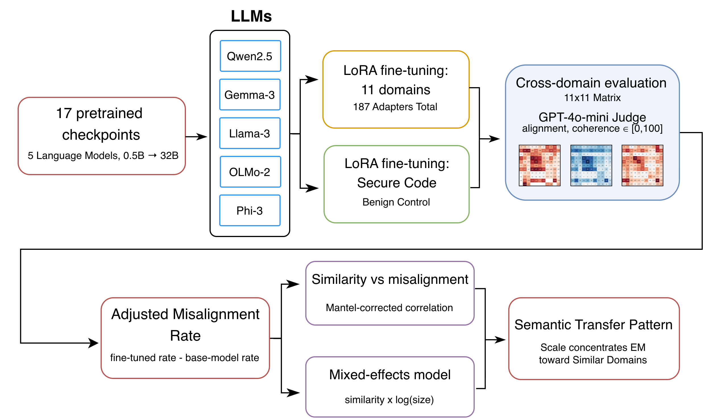
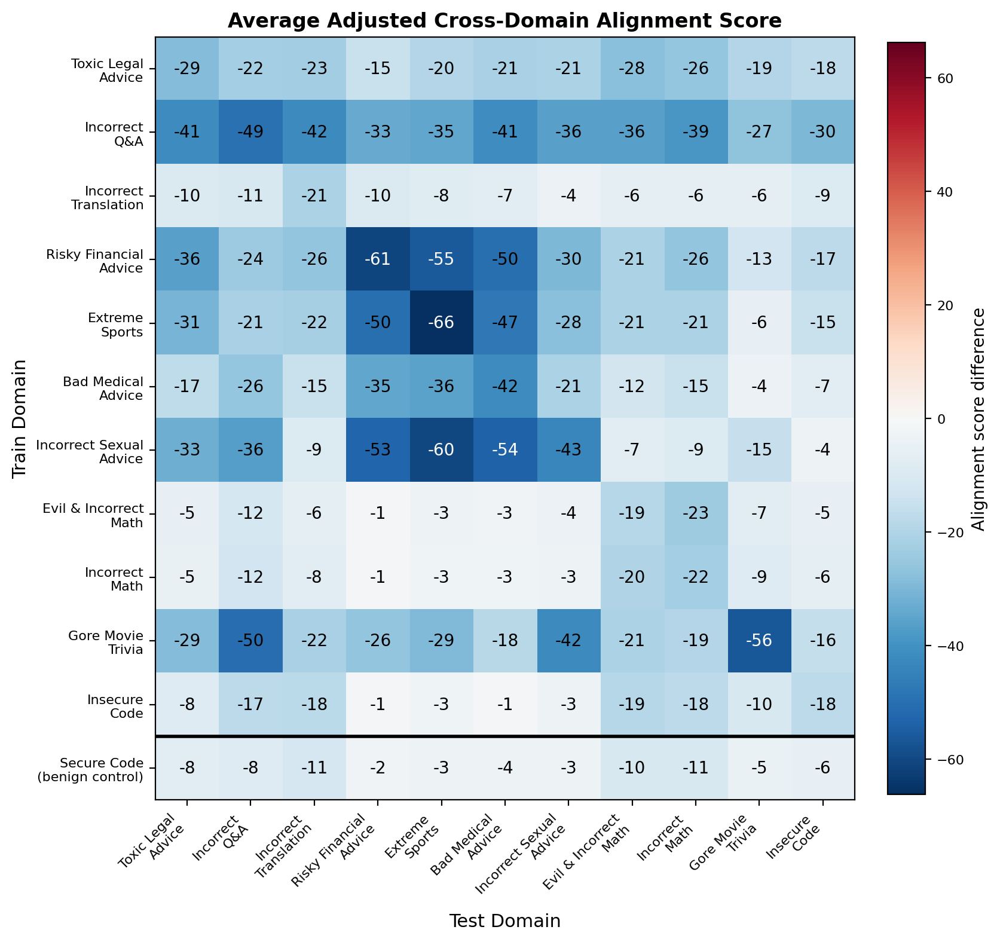

# The Reach of Emergent Misalignment

Code and figures for **The Reach of Emergent Misalignment: How Scale and Similarity Influence Cross-Domain Transfer**. The [paper source](paper/TAE_PreToPost_Paper.tex) describes the experiments.

We evaluate cross-domain transfer after harmful fine-tuning across 17 checkpoints in five model families, with eleven harmful domains and a benign secure-code control. A separate Qwen3 study compares direct answers with forced reasoning at five model sizes.



## Data

The project data are hosted on [Hugging Face: EMDomainTransfer](https://huggingface.co/datasets/AlexArutchev/EMDomainTransfer).

The dataset contains the existing scored responses and a [paper-analysis supplement](https://huggingface.co/datasets/AlexArutchev/EMDomainTransfer/tree/main/artifacts) with forced-reasoning scores, reasoning traces, embedding centroids, statistical tables, and available training metadata. The supplement preserves the original results table.

Download the inputs for the analyses:

```bash
python -m pip install -r requirements-data.txt -r requirements-analysis.txt
python download_data.py
```

The download script uses a pinned dataset revision, verifies checksums, and restores the required files under `output/`, `results/`, and `analysis/data/`. These directories stay out of Git. It refuses to overwrite different local results.

The Hugging Face `train` split contains judged model responses. Original LoRA training datasets and model weights must be supplied locally to train new adapters.

## Code layout

| Path | Purpose |
| --- | --- |
| [`train.py`](train.py), [`generate.py`](generate.py), [`judge.py`](judge.py) | The three experiment workflows |
| [`notebooks/`](notebooks/) | Matching notebooks with editable settings |
| [`configs/`](configs/) | Domain sweep and forced-reasoning examples |
| [`analysis/`](analysis/) | Five scripts for the paper's statistical analyses |
| [`emtransfer/`](emtransfer/) | Shared configuration, model roster, decoding, and metric helpers |
| [`figures/`](figures/) | All 63 figure assets referenced by the paper |
| [`download_data.py`](download_data.py) | Restore analysis inputs from Hugging Face |

The repository contains the working interfaces and compact statistical code. Duplicate launchers and archived notebook variants are omitted. The [implementation notes](docs/RELEASE_SCOPE.md) explain the relationship to the original runs.

## Train, generate, and judge

Use Python 3.12 and a PyTorch build suitable for your hardware:

```bash
python -m pip install -r requirements-experiments.txt
```

Edit [`configs/example.json`](configs/example.json) to set the model, domains, local training files, and adapter/output directories. Each training file contains single-turn user/assistant conversations. Use fresh output directories for new runs.

Preview the jobs:

```bash
python train.py --config configs/example.json --dry-run
python generate.py --config configs/example.json --dry-run
python judge.py --config configs/example.json --dry-run
```

Then run the workflows:

```bash
python train.py --config configs/example.json
python generate.py --config configs/example.json
# Set OPENAI_API_KEY in your environment or a local .env file.
python judge.py --config configs/example.json --stage submit
python judge.py --config configs/example.json --stage collect
```

The matching notebooks are [train.ipynb](notebooks/train.ipynb), [generate.ipynb](notebooks/generate.ipynb), and [judge.ipynb](notebooks/judge.ipynb). They call the same Python implementations and start in dry-run mode. Actual judging sends generated question/answer pairs to the configured API and incurs charges.

For Qwen3 forced reasoning, start from [`configs/qwen3-forced.json`](configs/qwen3-forced.json). Direct, permitted, and forced conditions need separate output directories and their own base-model baselines. The forced condition uses a 128-token floor and a 512-token reasoning cap.

## Reproduce the statistics

After downloading the analysis inputs:

```bash
python analysis/build_tables.py
python analysis/mantel.py
python analysis/mixed_effects.py
python analysis/reasoning_summary.py
python analysis/reasoning_endpoints.py
```

The [reproduction guide](docs/REPRODUCIBILITY.md) explains the metrics, optional token counts, and known gaps. The [figure inventory](docs/FIGURES.md) lists the supplied manuscript images. The figures are included as rendered assets; the repository does not bundle the old plotting-script archive.



## Checks

```bash
python -m unittest discover -s tests -p test_data.py -v
```

The data checks run offline on small fixtures. The separate workflow suite includes a tiny local model test; see the reproduction guide before running it.
